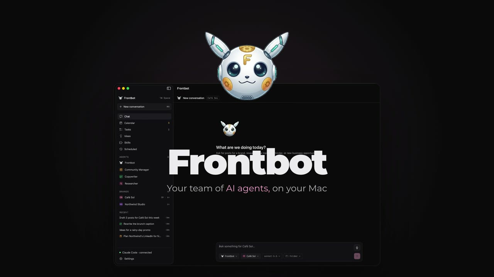

# Frontbot

A team of AI agents that lives on your Mac. Frontbot writes and organizes social media content for your brands, researches topics and business ideas, and helps with your daily tasks. Nothing is published without your click.

[](docs/media/frontbot-presentation.mp4)

▶ [Watch the presentation (1:30, MP4)](docs/media/frontbot-presentation.mp4)

## What it does

- **Chat with your agents.** Ask for posts, research or reminders like you would a teammate. Answers come in Markdown, and you can queue messages while an agent is working.
- **Brands.** Each brand has a brand guide (voice, topics, audience) and its own images. Agents read it before writing.
- **Posts and calendar.** Drafts for Instagram and LinkedIn land in a weekly or monthly calendar. You review and approve every post.
- **Assisted publishing.** Once a post is approved, Frontbot opens the network in your browser with the text and images ready. You make the final click.
- **Specialist agents.** Create your own agents, each with its instructions, model and skills.
- **Lab.** Agents study a topic on their own in bounded sessions, write down the evidence in a notebook and propose a new skill (or a better version of one) when something works. Nothing changes until you approve it.
- **Memory.** Agents remember what they learn about you. You can see every note and delete any of them.
- **Safety.** Agents only work in the folders you choose, only connect to the network sites you allow, and ask before writing a file. Skill scripts run in a sandbox and need your approval.
- **Ideas and scheduled tasks.** Business opportunities researched with sources and a score, and recurring tasks (every day, every week, every few minutes) that run while Frontbot is open.
- **Always at hand.** A panel in the notch with ⌥⌘ Space, and voice dictation in the chat.

Everything is stored locally on your Mac (SQLite plus files). The app is available in Spanish and English and follows the language of your Mac.

## Requirements

- macOS 15 or later on Apple Silicon.
- An [Anthropic API key](https://console.anthropic.com/settings/keys), or Claude Code signed in on the same Mac for personal use.
- To build: Xcode command line tools (Swift 6) and Node.js.

## Build and run

```bash
./scripts/build-app.sh        # builds build/Frontbot.app (release, ad-hoc signed)
open build/Frontbot.app
```

To distribute it, sign and notarize with a Developer ID certificate:

```bash
DEVELOPER_ID="Developer ID Application: Name (TEAMID)" NOTARY_PROFILE=frontbot ./scripts/build-app.sh
```

The script explains how to create the notarization profile, and writes `build/Frontbot.zip`.

## Development

```bash
cd app && swift build                              # macOS app (SwiftUI) and FrontbotCore
cd app && FRONTBOT_NODE=$(which node) swift test   # core tests
cd agent && npm install && npm test                # agent sidecar (Claude Agent SDK)
```

- `app/` — the native app: `FrontbotApp` (SwiftUI UI) and `FrontbotCore` (storage, rules, scheduling, agent client).
- `agent/` — the Node sidecar that runs the agents with the Claude Agent SDK, talking to the app over JSON-RPC.
- `app/Localization/en/` — English translations. Spanish strings in the code are the keys.
- `docs/superpowers/` — design specs and implementation plans.

### Demo data

`FRONTBOT_DATA_DIR` points the app at another data folder, and `FrontbotDemoSeed` fills an empty one with sample brands, posts, agents, memory and a lab topic:

```bash
cd app && FRONTBOT_DATA_DIR=/tmp/frontbot-demo swift run FrontbotDemoSeed
FRONTBOT_DATA_DIR=/tmp/frontbot-demo ../build/Frontbot.app/Contents/MacOS/Frontbot -AppleLanguages "(en)"
```

## Credits

Parts of Frontbot are based on [coucou](https://github.com/Louis-CFM/coucou) (MIT). See [THIRD_PARTY_NOTICES.md](THIRD_PARTY_NOTICES.md).
